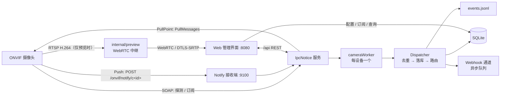

# IpcNotice

> 一个轻量的 ONVIF 事件网关：监听摄像头事件 → 按「设备 + 事件主题」匹配订阅 → 推送到 Webhook 通道，并提供 Web 管理界面。

后端是 Go 单进程 + 嵌入式 SQLite（纯 Go 实现，无需 cgo）；前端是 Vue 3 / Element Plus 管理界面，构建产物由 Go 同源托管。部署时只需要一个可执行文件、一份精简配置和数据库文件。

---

## 目录

- [功能](#功能)
- [技术栈](#技术栈)
- [架构](#架构)
- [快速开始](#快速开始)
- [配置](#配置)
- [管理界面](#管理界面)
- [REST API](#rest-api)
- [发版（GitHub Actions）](#发版github-actions)
- [事件与推送](#事件与推送)
- [设备兼容性](#设备兼容性)
- [安全说明](#安全说明)
- [开发](#开发)
- [许可证](#许可证)

---

## 功能

| 能力 | 说明 |
|---|---|
| 事件接入 | ONVIF Push（WS-BaseNotification）优先，不可用时自动回退 PullPoint；每 30 秒设备健康探测（连续 3 次失败判定离线，最长约 90 秒确认），断线指数退避自动重连（3s→120s，设备恢复在线立即重建订阅） |
| 设备管理 | 摄像头增删改、连接测试、ONVIF 设备信息采集（基本信息 / 系统信息 / 网络信息 / 分析配置） |
| 视频预览 | 摄像头管理页一键 WebRTC 预览：自动挑选 H.264 码流，RTSP → WebRTC 直转，不转码、不录像 |
| 事件发现 | 枚举 TopicSet + 短时实抓，主题按路径层级树状展示，可为事件配置中文名称 |
| 订阅匹配 | 按「设备 + 主题」订阅，支持 `/*` 通配子树，一条订阅可绑定多个通道 |
| 去重 | 冷却窗口语义：同键（设备+主题+操作+来源）首次放行，窗口内的心跳重复与状态抖动一律抑制 |
| 持续事件 | 订阅可配 `sustained` 模式：一轮活动只推送「开始 + 结束」两条；摄像头在活动中反复上报的状态翻转算同一轮，最后一次活动后静默 30 秒（可配，接收链路健康才判定）才推送结束通知 |
| 推送 | Webhook 固定 POST，支持自定义请求头、JSON 请求体模板（5 个占位符）、测试推送，以及按星期 + 时段配置「允许推送」窗口（窗口外为勿扰，事件仍落库） |
| 落库 | 事件同时写入 SQLite 与可选 JSONL 文件，便于查询与外部采集 |
| 运行诊断 | 每台设备的订阅创建 / 续约 / 退订结果、最近回调时间、回调来源计数 |
| 热更新 | 大部分配置保存后立即生效，无需重启服务 |

## 技术栈

| 层 | 选型 |
|---|---|
| 后端 | Go 1.26，`net/http`，`log/slog` |
| ONVIF | `github.com/mickeyzzc/onvif-go/v2` |
| 数据库 | `modernc.org/sqlite`（纯 Go，无 cgo，SQLite WAL） |
| 视频预览 | `github.com/bluenviron/gortsplib/v5`（RTSP）+ `github.com/pion/webrtc/v3`（WebRTC），均为纯 Go |
| 前端 | Vue 3 + Vite + Element Plus（pure-admin thin 模板，hash 路由） |
| 鉴权 | HttpOnly 会话 Cookie，24 小时有效，会话存于服务端内存 |

## 架构



- `Manager.Reload()` 在每次配置变更后从数据库重建路由表并热更新设备订阅。
- `Dispatcher` 负责去重、落库、按订阅主题匹配通道，再由固定数量的 worker 异步推送。
- Push 模式下摄像头需要能**反向访问**运行机的 Notify 地址，这是部署时最容易忽略的一点。

## 快速开始

### 前置条件

| 项 | 要求 |
|---|---|
| Go | 1.26 |
| Node | `^20.19.0 \|\| >=22.13.0` 与 pnpm >= 9（仅构建前端时需要） |
| 网络 | 运行机可访问摄像头 ONVIF/RTSP 端口；Push 模式还要求摄像头可访问运行机的 Notify 端口；视频预览要求浏览器可直连运行机并放行 UDP |
| cgo | 不需要，可交叉编译 |

### 构建与启动

### Release 压缩包

在 [Releases](../../releases) 下载对应平台的压缩包，解压后**直接运行即可**（前端已内嵌于二进制，无需任何额外目录）：

```bash
# Linux / macOS
chmod +x ipcnotice && ./ipcnotice

# Windows
ipcnotice.exe
```

首次启动会在当前目录生成 `config.json`（默认密码 `change-me`），**请立即修改后重启**，再打开 <http://127.0.0.1:8080>。仓库根目录的 `config.example.json` 是配置样例。

### 从源码构建

> 前端构建产物在 `go build` 时通过 `embed` 打包进二进制，因此**必须先把前端构建出来，再编译后端**。

```bash
# 1) 前端（必须先构建，否则 go build 会因 web/dist 不存在而失败）
cd web
pnpm install
pnpm build                       # 生成 web/dist（随后被内嵌进二进制）
cd ..

# 2) 后端（自动内嵌上一步的 web/dist）
go mod download
go build -o ipcnotice .          # Windows 下可用 -o ipcnotice.exe

# 3) 启动
./ipcnotice                      # 默认端口 8080
```

Windows 下可直接运行根目录的 `builder.bat`：先构建前端，再以 `CGO_ENABLED=0` 交叉编译三平台（`windows/amd64`、`linux/amd64`、`linux/arm64`），产物统一输出到外层 `dist/` 目录。

浏览器打开 <http://127.0.0.1:8080>，使用 `config.json` 中的账号密码登录。

**首次部署请立即修改默认登录密码并重启服务**，启动日志在仍使用默认密码时会给出告警。

### 首次配置四步

1. **摄像头管理 → 新增**：填写设备名称与 `onvif://<user>:<password>@<host>:<port>`，点「测试连接」确认型号、固件与事件能力；「设备信息」按钮可一次性采集 17 项 ONVIF 数据（单项不支持不影响其他项）；「预览」按钮可实时查看画面。
2. **Webhook 通道 → 新增**：填写 URL（固定 POST）、自定义请求头、超时，可选填 JSON 请求体模板；按需设置允许推送的星期（默认周一至周日）与时段（默认 00:00:00 - 23:59:59）；用「测试推送」预览实际发出的请求体（测试推送不受时间窗口限制）。
3. **事件订阅**：选择设备 → 抓取事件 → 在树状主题中勾选最后一级事件 → 填写中文名称 → 绑定通知渠道 → 保存。保存后立即热更新。
4. **运行态 / 事件日志**：确认 worker 已连接、回调计数在增长、事件 `matched / dispatched` 符合预期。

> 未绑定通道的订阅仍会匹配并落库，只是不外发。

### 命令行参数

| 参数 | 默认值 | 说明 |
|---|---|---|
| `-config` | `config.json` | 配置文件路径 |
| `-db` | `data/ipcnotice.db` | SQLite 文件 |
| `-web-dir` | `""`（空，使用内嵌前端） | 前端静态资源目录；留空则使用编译期内嵌的前端（单文件部署），指定磁盘目录可覆盖 |
| `-port` | `0`（不覆盖） | 覆盖配置文件中的端口 |
| `-log-file` | 空（仅 stdout） | 额外写日志文件 |
| `-debug` | `false` | DEBUG 级日志 |
| `-version` | — | 打印版本后退出 |

`Ctrl+C` / SIGTERM 会先撤销设备订阅，再关闭接收端与 HTTP 服务。

## 配置

### `config.json` 只有三个字段

```json
{
  "username": "admin",
  "password": "<改成你自己的密码>",
  "port": 8080
}
```

设备、通道、订阅、Notify 地址、去重窗口等**全部保存在数据库**，通过管理界面维护。不要把设备或通道写回 `config.json`，它不会被读取。

### 系统设置（界面「系统设置」）

| 字段 | 默认值 | 作用 | 热更新 |
|---|---|---|---|
| `notify_listen_addr` | `0.0.0.0:9100` | Notify 接收端监听地址 | 需重启 |
| `advertise_host` | `auto` | 写进订阅回调地址的主机；`auto` 通过 UDP 路由探测源 IP | 需重启 |
| `notify_path` | `/onvif/notify` | 回调路径前缀，实际为 `/onvif/notify/c<camera-id>` | 需重启 |
| `event_mode` | `auto` | `auto` / `push` / `pull` | 是 |
| `subscription_seconds` | `60` | Push 订阅有效期，到期自动续订 | 是 |
| `pull_timeout_seconds` | `30` | PullMessages 长轮询超时 | 是 |
| `message_limit` | `20` | 单次拉取最大条数 | 是 |
| `dedup_seconds` | `120` | 去重窗口，`0` 关闭 | 是 |
| `webhook_timeout_seconds` | `5` | 单次推送超时 | 需重启 |
| `webhook_workers` | `4` | 异步推送 worker 数 | 需重启 |
| `queue_size` | `1024` | 事件队列缓冲 | 需重启 |
| `max_event_logs` | `5000` | 事件日志保留上限 | 是 |
| `event_log_file` | `logs/events.jsonl` | JSONL 事件文件，留空关闭 | 是 |

`advertise_host` 必须是**摄像头能路由到**的地址，不能写 `127.0.0.1`；否则会出现「订阅建立成功但收不到事件」。

## 管理界面

| 页面 | 用途 |
|---|---|
| 概览 | 计数与运行状态速览 |
| 摄像头管理 | 设备增删改、连接测试、ONVIF 设备信息采集、WebRTC 视频预览 |
| 事件订阅 | 事件抓取、树状主题、中文名称、绑定通知渠道 |
| Webhook 通道 | 通道配置、请求体模板、推送时间窗口、测试推送 |
| 系统设置 | 运行参数 |
| 事件日志 | 分页查询、查看载荷，`matched / dispatched` 状态 |
| 运行态 | worker 状态、订阅诊断、回调计数、手动 Reload |

## REST API

- 基址：`http://<host>:8080/api`
- 鉴权：除 `/api/health` 与 `/api/login` 外均要求会话 Cookie；Cookie 为 `HttpOnly` + `SameSite=Lax`，有效期 24 小时，重启后需重新登录。
- 响应：成功返回 JSON，失败为 `{"error": "..."}` 与对应状态码。
- 完整契约见 `web/src/api/ipc.ts`。

| 分组 | 主要端点 |
|---|---|
| 会话 | `GET /api/health`、`POST /api/login`、`POST /api/logout`、`GET /api/me` |
| 摄像头 | `GET/POST /api/cameras`、`PUT/DELETE /api/cameras/{id}` |
| 探测 | `POST /api/cameras/{id}/test`、`POST /api/cameras/{id}/discover`、`POST /api/cameras/{id}/device-info` |
| 预览 | `POST /api/cameras/{id}/preview/offer`、`DELETE /api/cameras/{id}/preview/{session}` |
| 主题与订阅 | `GET/PUT /api/cameras/{id}/topics`、`GET /api/subscriptions`、`GET/PUT /api/cameras/{id}/subscriptions` |
| 通道 | `GET/POST /api/channels`、`PUT/DELETE /api/channels/{id}`、`POST /api/channels/{id}/test` |
| 设置与监控 | `GET/PUT /api/settings`、`GET /api/overview`、`GET /api/runtime`、`POST /api/runtime/reload`、`GET /api/events` |

```bash
# 健康检查（无需登录）
curl http://127.0.0.1:8080/api/health

# 登录后用 cookie 访问（凭据不要写进脚本或提交到仓库）
curl -c cookie.txt -H 'Content-Type: application/json' \
  -d '{"username":"<USER>","password":"<PASSWORD>"}' \
  http://127.0.0.1:8080/api/login
curl -b cookie.txt http://127.0.0.1:8080/api/runtime
```

### WebRTC 预览接口

| 方法 | 路径 | 说明 |
|---|---|---|
| POST | `/api/cameras/{id}/preview/offer` | body `{"sdp":"<浏览器 offer>"}`；后端选 H.264 码流、连 RTSP、创建 PeerConnection，返回 `{session, sdp, codec, profile, stream}` |
| DELETE | `/api/cameras/{id}/preview/{session}` | 关闭预览会话，立即释放设备 RTSP 连接 |

信令采用非 trickle ICE（answer 内含全部 host candidate），不依赖 STUN/TURN，适合局域网。会话默认最长 30 分钟，全局最多 6 路、单设备最多 2 路；关闭弹窗即释放。取流地址中的账号密码在响应与日志里均被遮蔽。

## 发版（GitHub Actions）

工作流：`.github/workflows/release.yml`。

- **推标签自动发版**：`git tag v0.2.0 && git push origin v0.2.0`
- **手动运行**：GitHub → Actions → `Build & Release` → Run workflow，填写版本号（例如 `v0.2.0`）与是否预发布。

流程：先构建一次前端 `web/dist`（由 vite 输出到仓库内）→ `go vet` / `go test`（此时已内嵌前端）→ `CGO_ENABLED=0` 交叉编译 3 个目标（Windows amd64、Linux amd64/arm64）→ 每包内含**已内嵌前端的可执行文件**、`README.md`、`config.example.json` 与 `VERSION` → 生成 `SHA256SUMS.txt` 并创建 GitHub Release。版本号通过 `-ldflags "-X main.version=<tag>"` 注入。

> 因为前端在编译期已 `embed` 进二进制，Release 包不再包含 `web/dist` 目录，解压即为单文件部署。

> 打包时只会复制上述公开文件；`config.json`、数据库、日志与本地协作文档已在 `.gitignore` 中排除，不会进入仓库或 Release。

## 事件与推送

### 统一事件 JSON

通道未配置模板时，事件对象本身就是 webhook 请求体。

| 字段 | 含义 |
|---|---|
| `event_id` | 唯一 ID |
| `device` / `device_host` | 设备名 / 主机 |
| `transport` | `push` 或 `pull` |
| `topic` | 原始事件主题 |
| `title` | 事件中文名称（未配置时回退为主题最后一段） |
| `property_operation` | `Changed` / `Initialized` 等 |
| `device_time` / `received_at` | 设备时间 / 接收时间 |
| `source` / `key` / `data` | SimpleItem 键值映射 |

### 关键规则

1. **主题归一化**：比较前去掉每段命名空间前缀（如 `tns1:`），匹配支持精确匹配、`*` 全匹配与 `/*` 子树通配。
2. **去重是冷却窗口**：键为「设备 + 归一化主题 + operation + source」，**不含设备时间戳**；键首次出现放行，TTL 窗口内的所有后续事件（同状态心跳、TP-Link 侦测抖动造成的 true/false 快速翻转）一律抑制，窗口过期后重新放行。抑制时不刷新窗口，持续抖动最多每个窗口收到一次推送。窗口由 `dedup_seconds` 控制（默认 120s，`0` 关闭）。
3. **请求体模板**：模板必须是合法 JSON，占位符写在字符串值内，渲染时自动做 JSON 转义（换行→`\n`）；留空则推送完整事件 JSON。推送方法固定 POST。

   | 占位符 | 渲染结果 |
   |---|---|
   | `{title}` | `摄像头{设备名} 发生-{事件中文名}` |
   | `{content}` | 带标题头的多行文本（`📹IpcNotice订阅消息通知` / `摄像头：xxx` / `事件：发生了xxx事件` / `触发时间：yyyy-MM-dd HH:mm:ss`） |
   | `{devname}` | 设备名称 |
   | `{eventname}` | 事件名称（订阅里填写的中文名，未填时为主题末段） |
   | `{evettime}` | 触发时间 `yyyy-MM-dd HH:mm:ss`（兼容别名 `{eventtime}`） |

   所有时间按北京时间（UTC+8）展示；占位符一次性替换，替换值不会被二次解析。
4. **推送时间窗口**：每条通道可设置允许推送的星期（默认全部）与每日时段（默认 `00:00:00 - 23:59:59`，闭区间）。两个条件**同时满足**才发起推送，否则为勿扰时段——事件照常去重、落库与记录日志，只是不外发；`dispatched` 记为未推送。按北京时间（UTC+8）判断，时段不跨天（开始时间不得晚于结束时间）；手动「测试推送」不受限制。旧通道升级后默认全周全天，行为不变。
5. **事件标题**：来自「事件订阅」页填写的中文名，在写库与推送之前统一注入，因此日志、数据库与 webhook 内容一致。

## 设备兼容性

项目面向标准 ONVIF Event 设备，并针对部分固件的实际行为做了兼容处理：

- **非法 XML**：某些设备 `GetEventProperties` 返回未加引号的属性，`internal/onvifcore/transport.go` 在 SOAP 解析前修正。
- **主题声明与实际推送不一致**：实际事件可能落在与 TopicSet 声明树不同的路径下，统一走主题归一化后比对，不做严格树状过滤。
- **回调路径必须为 ASCII**：部分固件无法正确处理 percent-encoded 的中文路径，因此回调路径使用 `c<camera-id>` token，设备名只用于显示；token 由数据库自增 ID 推导，改名不会使订阅失效。
- **设备不遵守订阅 TTL**：进程异常退出可能残留订阅占用设备订阅槽。程序会把订阅管理地址持久化，下次建立订阅前尽力退订残留订阅；若设备端订阅槽已耗尽（表现为新订阅成功但零回调），需要给摄像头断电重启彻底清理。
- **设备能力查询**：`MaxNotificationProducers`（Push 订阅槽上限）来自 Event 服务的 `GetServiceCapabilities`，可在「设备信息」页查看；部分操作（如系统日志、支持信息）可能返回 `ActionNotSupported`，界面按「不支持」展示，不影响其他项。
- **主码流可能是 H.265**：浏览器 WebRTC 普遍只支持 H.264，因此预览会遍历 ONVIF Profile，自动选择含 H.264 的码流（通常是子码流）；只有 H.265 的设备无法预览，但事件订阅与推送不受影响。预览要求浏览器能直连运行机（放行 UDP）。

管理界面的「设备信息」弹窗按四个分区采集 17 项 ONVIF 数据：基本信息、系统信息、网络信息、分析配置（分析模块与规则）。单项失败互不影响。

## 安全说明

- **首次启动必须修改默认登录密码**（`config.json` 的 `password`），启动日志会在仍使用默认密码时告警。
- `config.json`、数据库、事件日志与本地协作文档均包含凭据或运行数据，已在 `.gitignore` 中排除；提交前请确认没有把它们加入版本控制。
- 设备 ONVIF 凭据以明文保存在数据库 `cameras` 表中，日志与 API 输出会遮蔽密码，但备份数据库时需注意权限。
- 管理界面默认面向本机/内网使用，未内置 HTTPS、多用户与 RBAC；如需对外暴露，请置于反向代理之后并启用 TLS 与访问控制。
- Webhook 目标 URL 由管理员填写，请避免指向不可信地址（存在 SSRF 面）。

## 开发

```bash
# 后端
gofmt -w *.go
go test ./...
go vet ./...
go build -o ipcnotice .

# 前端
cd web
pnpm typecheck
pnpm build          # 改前端后必做；go build 前必须先构建，否则 embed 失败
```

目录速览：

```
IpcNotice/
├── README.md              # 公开项目说明（本文件）
├── config.example.json    # 配置样例（无真实凭据）
├── config.json            # 仅 username / password / port（含凭据，已忽略）
├── go.mod / go.sum
├── main.go / embed.go     # 入口组装与前端内嵌（embed 要求放在仓库根）
├── internal/              # Go 后端（按职责分包）
│   ├── config/            # 配置模型（config.json + 运行期 Settings）
│   ├── store/             # SQLite 数据层与旧版配置迁移
│   ├── util/              # 共享叶子函数（主题归一化/匹配等）
│   ├── onvifcore/         # ONVIF 客户端、Notify 接收端、订阅 worker
│   ├── dispatch/          # 事件信封、去重、落库与 webhook 路由推送
│   ├── manager/           # 运行时编排与热重载（实现 onvifcore.WorkerHost）
│   ├── probe/             # 设备连通性测试与 ONVIF 信息聚合
│   ├── preview/           # WebRTC 视频预览中继（RTSP → WebRTC）
│   └── server/            # REST API 与前端静态托管
├── builder.bat            # 一键构建（前端 + 三平台交叉编译，产物在 dist/）
├── .github/workflows/     # GitHub Actions 编译发版
├── dist/                  # 本地编译产物（已忽略）
├── data/                  # SQLite（运行时生成，已忽略）
├── logs/                  # 运行日志与 events.jsonl（已忽略）
└── web/
    ├── src/api/ipc.ts     # REST 契约
    ├── src/views/         # 业务页面
    ├── src/router/        # 菜单与路由
    ├── public/            # 站点图标与全局配置
    └── dist/              # 前端构建产物，编译期由 Go 通过 embed 内嵌进二进制
```

主要模块：`internal/config` 配置模型、`internal/store` 数据库、`internal/manager` 热重载、`internal/onvifcore` 订阅生命周期与回调接收（`listen.go`/`notify.go`/`transport.go`）、`internal/dispatch` 去重与推送、`internal/probe` 设备探测、`internal/preview` WebRTC 预览中继、`internal/server` REST 接口。

## 许可证

本项目暂未指定开源许可证。

## 致谢

依赖的开源项目：`onvif-go`（ONVIF 协议实现）、`gortsplib`（RTSP 客户端）、`pion/webrtc`（WebRTC）、`vue-pure-admin` 与 Element Plus（管理界面）、`modernc.org/sqlite`（纯 Go SQLite 驱动）。
